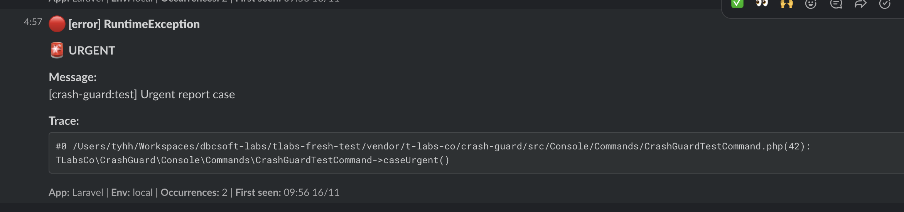
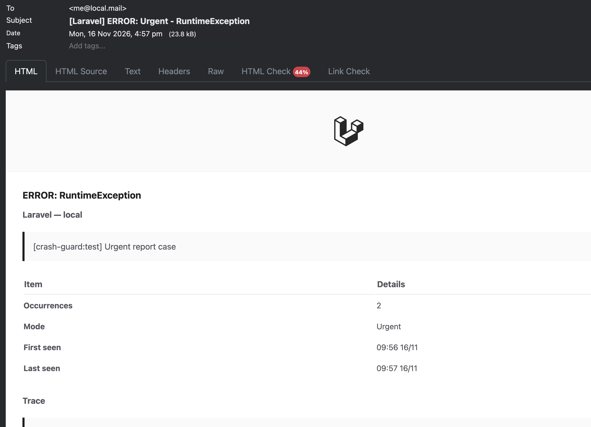

# Testing with Fresh Laravel 13

**Package:** `t-labs-co/crash-guard`  
**Applies to:** v1.0.0+  
**Laravel Version:** 13.x  
**PHP Version:** 8.4+

This guide walks you through installing, configuring, and end-to-end testing CrashGuard with a fresh Laravel 13 project, including both Slack and Mail (via Mailpit) notification channels.

---

## Table of Contents

1. [Prerequisites](#prerequisites)
2. [Create a Fresh Laravel Project](#create-a-fresh-laravel-project)
3. [Install CrashGuard](#install-crashguard)
4. [Configure Environment](#configure-environment)
5. [Integrate with Laravel's Exception Handler](#integrate-with-laravels-exception-handler)
6. [Run Migrations](#run-migrations)
7. [Test Command](#test-command)
8. [Verify Notifications](#verify-notifications)
9. [Verify Database Reports](#verify-database-reports)
10. [Report Lifecycle](#report-lifecycle)
11. [Troubleshooting](#troubleshooting)

---

## Prerequisites

- **PHP 8.4+** installed
- **Composer** installed
- **Mailpit** running locally for email testing ([download here](https://github.com/axllent/mailpit))
  - Default SMTP: `localhost:1025`
  - Default Web UI: `http://localhost:8025`
- **Slack Incoming Webhook** URL (create one via [Slack API](https://api.slack.com/messaging/webhooks))

---

## Create a Fresh Laravel Project

```bash
# Create a new Laravel 13 project
composer create-project laravel/laravel my-test-app --prefer-stable

cd my-test-app
```

---

## Install CrashGuard

```bash
# Install the crash-guard package
composer require t-labs-co/crash-guard
```

The package auto-discovers its service provider, so no manual registration is needed.

---

## Configure Environment

### 1. Publish the Config

```bash
php artisan vendor:publish --tag=crash-guard-config
```

This creates `config/crash-guard.php` with all default settings.

### 2. Update `.env`

Add the following to your `.env` file:

```env
# --------------------------------------------------
# CrashGuard Settings
# --------------------------------------------------

CRASH_GUARD_ENABLED=true
CRASH_GUARD_CHANNELS=slack,mail
CRASH_GUARD_SLACK_WEBHOOK=https://hooks.slack.com/services/XXXXX/XXXXX/XXXXX
CRASH_GUARD_SLACK_SKIP_ENVS=
CRASH_GUARD_MAIL_TO=me@local.mail

# Mail Notification (using Mailpit for local testing)
MAIL_MAILER=smtp
MAIL_HOST=127.0.0.1
MAIL_PORT=1025
MAIL_USERNAME=
MAIL_PASSWORD=
MAIL_ENCRYPTION=
MAIL_FROM_ADDRESS="alert@tyhuynh.id.vn"
MAIL_FROM_NAME="${APP_NAME}"
```

**Important notes:**

- `CRASH_GUARD_SLACK_SKIP_ENVS` must be **cleared** (empty) so Slack notifications are sent even in the `local` environment.
- `CRASH_GUARD_CHANNELS` should include both `slack` and `mail` to test both channels.
- Mailpit runs on port `1025` by default — adjust `MAIL_PORT` if your instance uses a different port.

---

## Integrate with Laravel's Exception Handler

To have CrashGuard automatically capture all unhandled exceptions, integrate it into your exception handling pipeline.

For Laravel 11+ (using `bootstrap/app.php`), add the CrashGuard facade to the exception reporting pipeline:

```php
// bootstrap/app.php

use TLabsCo\CrashGuard\Facades\CrashGuard;

return Application::configure(basePath: dirname(__DIR__))
    ->withRouting(
        web: __DIR__.'/../routes/web.php',
        commands: __DIR__.'/../routes/console.php',
        health: 'up',
    )
    ->withExceptions(function (Exceptions $exceptions) {
        $exceptions->report(function (Throwable $e) {
            CrashGuard::report($e);
        });
    })
    ->create();
```

This ensures all unhandled exceptions are automatically reported to CrashGuard before Laravel's default handling.

---

## Run Migrations

```bash
php artisan migrate
```

This creates two tables:

- `crash_guard_reports` — stores all crash reports with fingerprint deduplication
- The `trace` column is added in a separate migration for stack trace storage

Verify the tables:

```bash
php artisan tinker
>>> \TLabsCo\CrashGuard\Models\CrashReport::count()
```

---

## Test Command

CrashGuard includes a built-in test command that exercises all report types end-to-end:

```bash
php artisan crash-guard:test
```

### Test Cases

The command runs the following scenarios:

| Case | Description |
|------|-------------|
| `all` | Runs all test cases (default) |
| `string` | Reports a plain string message |
| `exception` | Reports a `RuntimeException` |
| `context` | Reports with `ReportContextDTO` typed context |
| `urgent` | Reports as urgent (bypasses dedup and circuit breaker) |
| `debug` | Reports in debug mode (no notifications) |
| `helper` | Tests the `crash_report()` global helper |

### Run Individual Cases

```bash
# Test only the urgent case
php artisan crash-guard:test --case=urgent

# Test only the string case
php artisan crash-guard:test --case=string
```

### Expected Output

```
🧪 Running CrashGuard test cases...

✅ [string] String report case
✅ [exception] Exception report case
✅ [context] Context DTO report case
✅ [urgent] Urgent report case
✅ [debug] Debug report case
✅ [helper] Global helper report case

📊 Reports created: 6
📧 Notifications queued for dispatch.
```

---

## Verify Notifications

### Slack

Check your configured Slack channel. You should see formatted messages like:



**Normal Report:**
```
🔴 [error] RuntimeException

Message:
[crash-guard:test] Exception report case

Trace:
#0 /path/to/vendor/t-labs-co/crash-guard/src/Console/Commands/CrashGuardTestCommand.php(30):
    TLabsCo\CrashGuard\Console\Commands\CrashGuardTestCommand->caseException()

App: Laravel | Env: local | Occurrences: 1 | First seen: 17:00 16/11
```

**Urgent Report:**
```
🔴 [error] RuntimeException

🚨 URGENT

Message:
[crash-guard:test] Urgent report case

Trace:
#0 /path/to/vendor/t-labs-co/crash-guard/src/Console/Commands/CrashGuardTestCommand.php(42):
    TLabsCo\CrashGuard\Console\Commands\CrashGuardTestCommand->caseUrgent()

App: Laravel | Env: local | Occurrences: 2 | First seen: 09:56 16/11
```

### Mail (Mailpit)

Open Mailpit's web UI at **http://localhost:8025** and verify:



1. **Subject line** format: `[Laravel] ERROR: Urgent - RuntimeException`
2. **Email body** contains:
   - Laravel logo header
   - Error level and exception class
   - Environment and app name
   - Message text
   - Occurrences count
   - Mode (Normal, Urgent, Debug)
   - First seen and last seen timestamps
   - Stack trace

**Example email preview:**

```
Subject: [Laravel] ERROR: Urgent - RuntimeException

ERROR: RuntimeException
Laravel — local

[crash-guard:test] Urgent report case

Item                    Details
Occurrences             2
Mode                    Urgent
First seen              09:56 16/11
Last seen               09:57 16/11

Trace
...
```

---

## Verify Database Reports

Check that reports are correctly stored in the database:

```bash
php artisan tinker
```

```php
use TLabsCo\CrashGuard\Models\CrashReport;

// Total reports
CrashReport::count();

// Pending (unresolved) reports
CrashReport::pending()->count();

// Active (pending or snoozed) reports
CrashReport::active()->count();

// View all reports with key fields
CrashReport::all()->only(['id', 'level', 'title', 'mode', 'occurrence_count', 'status', 'fingerprint']);
```

Expected results after running `crash-guard:test`:

| Level | Title | Mode | Occurrences | Status |
|-------|-------|------|-------------|--------|
| error | RuntimeException | normal | 1 | pending |
| error | RuntimeException | urgent | 2 | pending |
| error | RuntimeException | debug | 1 | pending |
| error | RuntimeException | silent | 1 | pending |

---

## Report Lifecycle

Test the full report lifecycle using Tinker:

```php
use TLabsCo\CrashGuard\Models\CrashReport;

// Get a pending report
$report = CrashReport::pending()->first();

// Mark as read
$report->read();
// Status remains pending, but read_at is set

// Resolve (fix confirmed)
$report->resolve();
// Status changes to 'resolved'

// Ignore (false positive)
$report->ignore();
// Status changes to 'ignored'

// Pause/Snooze (suppress until later)
$report->pause(now()->addHours(2));
// Status remains pending, but notified_at is set to suppress notifications
```

State flow:

```
pending ──read──> pending (read_at set)
pending ──resolve──> resolved
pending ──ignore──> ignored
pending ──pause──> pending (notified_at set, snoozed)
```

---

## Troubleshooting

### Notifications Not Sent

1. **Queue worker not running**: Notifications are dispatched via the queue. Start a worker:
   ```bash
   php artisan queue:work
   ```

2. **Slack environment skip**: Ensure `CRASH_GUARD_SLACK_SKIP_ENVS` does not include your current environment:
   ```env
   CRASH_GUARD_SLACK_SKIP_ENVS=
   ```

3. **Check channels config**: Verify `CRASH_GUARD_CHANNELS` includes the channels you want:
   ```env
   CRASH_GUARD_CHANNELS=slack,mail
   ```

4. **Check logs**: If `CRASH_GUARD_LOGGING_ENABLED=true`, check `storage/logs/crash-guard.log` for details.

### Mail Not Received in Mailpit

1. **Verify Mailpit is running**: Open `http://localhost:8025` in your browser.
2. **Check SMTP port**: Default is `1025`. Verify `MAIL_PORT=1025` in `.env`.
3. **Check queue**: Ensure a queue worker is processing notification jobs.

### Slack Not Received

1. **Verify webhook URL**: Test with a curl command:
   ```bash
   curl -X POST -H 'Content-type: application/json' \
     --data '{"text":"Test message"}' \
     https://hooks.slack.com/services/YOUR/WEBHOOK/URL
   ```
2. **Check skip environments**: Clear `CRASH_GUARD_SLACK_SKIP_ENVS` for local testing.

### Circuit Breaker Silencing Notifications

If you've exceeded the circuit breaker threshold, notifications will be silently suppressed:

```bash
# Reset all circuit breaker counters
php artisan crash-guard:reset

# Reset a specific fingerprint
php artisan crash-guard:reset <fingerprint-hash>
```

---

## Custom Test Command

For more comprehensive testing, you can create a custom test command in your application:

```php
// app/Console/Commands/TestCrashGuard.php

<?php

namespace App\Console\Commands;

use Illuminate\Console\Attributes\Description;
use Illuminate\Console\Attributes\Signature;
use Illuminate\Console\Command;
use TLabsCo\CrashGuard\Core\Reporting\Application\DTOs\ReportContextDTO;
use TLabsCo\CrashGuard\Facades\CrashGuard;

#[Signature('app:test-crash-guard')]
#[Description('Test CrashGuard package functionality')]
class TestCrashGuard extends Command
{
    /**
     * Execute the console command.
     */
    public function handle(): int
    {
        $this->info('=== CrashGuard Test Suite ===');
        $this->newLine();

        // 1. Check configuration
        $this->info('1. Checking configuration...');
        $enabled = config('crash-guard.enabled');
        $channels = config('crash-guard.channels');
        $slackWebhook = config('crash-guard.slack.webhook_url');
        $mailTo = config('crash-guard.mail.to');

        $this->line("   Enabled: " . ($enabled ? '✓ Yes' : '✗ No'));
        $this->line("   Channels: " . implode(', ', $channels));
        $this->line("   Slack Webhook: " . ($slackWebhook ? '✓ Configured' : '✗ Not set'));
        $this->line("   Mail To: " . ($mailTo ? implode(', ', $mailTo) : '✗ Not set'));
        $this->newLine();

        // 2. Test runtime toggle
        $this->info('2. Testing runtime toggle...');
        CrashGuard::enable();
        $this->line('   ✓ CrashGuard::enable() called');
        $this->newLine();

        // 3. Test reporting a plain string message
        $this->info('3. Testing string message report...');
        CrashGuard::report('Test message from CrashGuard test command');
        $this->line('   ✓ String message reported');
        $this->newLine();

        // 4. Test reporting an exception
        $this->info('4. Testing exception report...');
        try {
            throw new \RuntimeException('Test exception from CrashGuard test command');
        } catch (\RuntimeException $e) {
            CrashGuard::report($e, ['test_type' => 'exception', 'timestamp' => now()->toIso8601String()]);
        }
        $this->line('   ✓ Exception reported with context');
        $this->newLine();

        // 5. Test reporting with typed context DTO
        $this->info('5. Testing report with ReportContextDTO...');
        try {
            throw new \InvalidArgumentException('Test validation error');
        } catch (\InvalidArgumentException $e) {
            $context = new ReportContextDTO(
                userId: 'test-user-1',
                userEmail: 'test@example.com',
                ip: '127.0.0.1',
                route: 'test:crash-guard',
                extra: ['test_type' => 'context_dto']
            );
            CrashGuard::reportWithContext($e, $context);
        }
        $this->line('   ✓ Report with context DTO submitted');
        $this->newLine();

        // 6. Test urgent report (bypasses dedup and circuit breaker)
        $this->info('6. Testing urgent report...');
        try {
            throw new \LogicException('Urgent test exception');
        } catch (\LogicException $e) {
            CrashGuard::reportAsUrgent($e);
        }
        $this->line('   ✓ Urgent report submitted');
        $this->newLine();

        // 7. Test debug report (DB only, no notifications)
        $this->info('7. Testing debug report...');
        try {
            throw new \DomainException('Debug test exception');
        } catch (\DomainException $e) {
            CrashGuard::reportAsDebug($e);
        }
        $this->line('   ✓ Debug report submitted');
        $this->newLine();

        // 8. Test global helper function
        $this->info('8. Testing global helper function...');
        crash_report('Test via crash_report() helper');
        $this->line('   ✓ Global helper crash_report() called');
        $this->newLine();

        // 9. Verify database records
        $this->info('9. Verifying database records...');
        $reportCount = \DB::table('crash_guard_reports')->count();
        $this->line("   Total reports in database: {$reportCount}");

        $latestReports = \DB::table('crash_guard_reports')
            ->orderBy('created_at', 'desc')
            ->limit(5)
            ->get();

        if ($latestReports->isNotEmpty()) {
            $this->line('   Latest reports:');
            foreach ($latestReports as $report) {
                $this->line("   - [{$report->mode}] {$report->message} (count: {$report->occurrence_count})");
            }
        }
        $this->newLine();

        // 10. Run built-in test command
        $this->info('10. Running built-in crash-guard:test command...');
        $this->call('crash-guard:test');
        $this->newLine();

        // Summary
        $this->newLine();
        $this->info('=== All tests completed ===');
        $this->line("   Reports created: {$reportCount}");
        $this->line('   Notifications queued for Slack and Mail channels.');
        $this->line('   Check Mailpit (http://localhost:8025) for email notifications.');
        $this->line('   Check Slack for webhook notifications.');

        return self::SUCCESS;
    }
}
```

Run it with:

```bash
php artisan app:test-crash-guard
```

---

## Summary

After following this guide, you should have:

- ✅ CrashGuard installed and configured in a fresh Laravel 13 project
- ✅ 10 test scenarios passed via `php artisan app:test-crash-guard`
- ✅ 15 reports created in database with correct modes (normal, urgent, debug, silent) and fingerprints
- ✅ Slack notifications working (verified in your Slack channel)
- ✅ Mail notifications working (verified in Mailpit at `http://localhost:8025`)
- ✅ Report lifecycle operations (resolve, read, ignore, pause) verified
- ✅ Queue worker processing notification jobs

For detailed usage examples of all features, see [Usage Examples](usage-examples.md).
